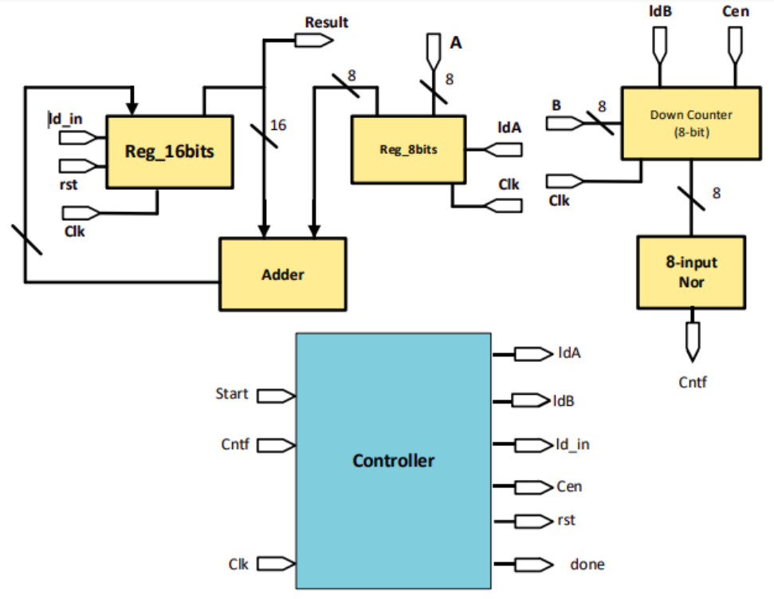

# 10. RTL Projects: 8-bit Multiplier

Up to this point, we have focused on isolated circuits. In RTL design, however, the goal is to build complete systems. In this project, we will build an **8-bit Multiplier** using the **Summation Methodology** (repeated addition).

This is a foundational project because it introduces the most important architectural pattern in digital design: **separating the Datapath from the Controller**.

## 10.1 System Architecture: Datapath vs. Controller



As shown in the block diagram above, the multiplier is divided into two distinct parts:

1.  **Datapath:** The "muscle" of the system. It contains the registers, the adder, and the counter. It does not know *what* to do or *when* to do it; it only moves data when told to.
2.  **Controller:** The "brain" of the system. It is a Finite State Machine (FSM) that reads inputs (like `start` and `Cntf`) and generates control signals (like `ld_A`, `Cen`, `rst`) to tell the Datapath what to do.

### How the System Operates
The system receives two 8-bit numbers, **A** and **B**, and calculates their 16-bit product. 
1. When the `start` signal goes high, the Controller loads **A** into the 8-bit register and **B** into the 8-bit down counter. It also resets the 16-bit result register.
2. During calculation, the Controller repeatedly enables the adder. The Datapath takes the current result, adds **A** to it, and stores it back in the 16-bit register.
3. Simultaneously, the down counter decreases by 1. 
4. When the counter reaches zero (`Cntf` becomes 1), the Controller knows it has added **A** exactly **B** times. It sets the `done` signal high and stops the operation.

## 10.2 The Top-Level Module

The top-level module simply instantiates the Datapath and the Controller and wires them together.

```verilog
module Multiplier(clk, reset, go, A, B, done, Result);
    input  [7:0] A, B;
    input  clk, go, reset;
    output [15:0] Result;
    output done;

    wire ld_A, ld_B, ld_Result, rst, Cen, Cntf;

    // Instantiate the Datapath
    DataPath inst_DP (
        .clk(clk), .A(A), .B(B), 
        .ld_A(ld_A), .ld_B(ld_B), .ld_Result(ld_Result), 
        .Result(Result), .rst(rst), .Cen(Cen), .Cntf(Cntf)
    );

    // Instantiate the Controller
    Controller inst_CTRL (
        .clk(clk), .reset(reset), .go(go), 
        .Cntf(Cntf), .done(done), 
        .ld_A(ld_A), .ld_B(ld_B), .Cen(Cen), 
        .ld_Result(ld_Result), .rst(rst)
    );
endmodule
```

## 10.3 The Datapath

The Datapath instantiates the registers, adder, and counter, connecting them with wires.

```verilog
module DataPath(clk, A, B, ld_A, ld_B, ld_Result, Result, rst, Cen, Cntf);
    input [7:0] A, B;
    input clk, ld_A, ld_B, ld_Result, rst, Cen;
    output [15:0] Result;
    output Cntf;
    wire [15:0] regout2, result_in;
    wire [7:0] regout1, Z;

    Register_8bits  M1 (clk, ld_A, A, regout1);
    Adder           M2 (regout1, regout2, result_in);
    Register_16bits M3 (clk, rst, ld_Result, result_in, regout2);
    Counter_8bits   M4 (clk, B, ld_B, Cen, Z, Cntf);

    assign Result = regout2;
endmodule
```

## 10.4 The Controller (FSM)

The Controller is a Hoffman based state machine. It has four states: `start`, `load`, `calc`, and `out`.

```verilog
module Controller(clk, reset, go, Cntf, done, ld_A, ld_B, Cen, ld_Result, rst);
    input clk, reset, go, Cntf;
    output reg done, ld_A, ld_B, Cen, ld_Result, rst;
    parameter start=2'b00, load=2'b01, calc=2'b10, out=2'b11;

    reg [1:0] PS, NS;

    always @(go, PS, Cntf) begin
        // Default outputs
        NS = start;
        done = 1'b0; ld_A = 1'b0; ld_B = 1'b0;
        Cen = 1'b0; ld_Result = 1'b0; rst = 1'b0;

        case (PS)
            start: begin
                if (go == 1'b1) NS = load;
                else            NS = start;
            end

            load: begin
                ld_A = 1'b1; ld_B = 1'b1; rst = 1'b1;
                NS = calc;
            end

            calc: begin
                if (Cntf == 1'b0) begin
                    NS = calc;
                    Cen = 1'b1; ld_Result = 1'b1;
                end
                else begin
                    NS = out;
                end
            end

            out: begin
                done = 1'b1;
                NS = start;
            end
        endcase
    end

    always @(posedge clk) begin
        if (reset == 1'b1) PS <= start;
        else               PS <= NS;
    end
endmodule
```

## 10.5 Sub-components

Here are the smaller modules instantiated inside the Datapath.

### Adder
```verilog
module Adder(a, b, y);
    input [7:0] a;
    input [15:0] b;
    output [15:0] y;
    assign y = a + b;
endmodule
```

### 8-bit Down Counter
```verilog
module Counter_8bits(clk, B, ld_B, Cen, Z, Cntf);
    input [7:0] B;
    input clk, ld_B, Cen;
    output reg [7:0] Z;
    output Cntf;
    
    always @(posedge clk) begin 
        if (ld_B)
            Z <= B;
        else if (Cen)
            Z <= Z - 1;		
    end
    assign Cntf = (Z == 8'b0) ? 1'b1 : 1'b0;
endmodule
```

### 8-bit Register (for A)
```verilog
module Register_8bits(clk, ld_A, A, out);
    input clk, ld_A;
    input [7:0] A;
    output reg [7:0] out;

    always @(posedge clk) begin
        if (ld_A) out <= A;
    end
endmodule
```

### 16-bit Register (for Result)
```verilog
module Register_16bits(clk, rst, ld, inp, out);
    input [15:0] inp;
    input clk, rst, ld;
    output reg [15:0] out;
    
    always @(posedge clk) begin 
        if (rst)
            out <= 16'b0;
        else if (ld)
            out <= inp;
    end	
endmodule
```

## 10.6 The Testbench

To verify this system, the testbench applies a few multiplication test cases and observes the `done` signal and `Result`.

```verilog
`timescale 1ns / 1ps

module Multiplier_TB();
    reg clk, go, reset;
    reg [7:0] A, B;
    wire done;
    wire [15:0] Result;

    Multiplier uut (clk, reset, go, A, B, done, Result);
    
    always #5 clk = ~clk;

    initial begin
        clk = 1'b0; reset = 1'b0; go = 1'b0;
        
        // Test 1: 10 * 4 = 40
        A = 8'b1010; B = 8'b100;
        #10 go = 1'b1;
        #10 go = 1'b0;
        #100;

        // Test 2: 7 * 5 = 35
        A = 8'b111; B = 8'b101;
        #10 go = 1'b1;
        #10 go = 1'b0;
        #100;

        // Test 3: 6 * 10 = 60
        A = 8'b110; B = 8'b1010;
        #10 go = 1'b1;
        #10 go = 1'b0;
        
        #150 reset = 1'b1;
        #10 $finish;
    end
endmodule
```

## 10.7 Key Takeaways
1.  **Separation of Concerns:** The Datapath knows *how* to add and store; the Controller knows *when* to do it.
2.  **Control Signals:** The Controller acts as the orchestrator, flipping the `ld_` (load) and `Cen` (count enable) switches at the right time.
3.  **Scalability:** If you wanted a 16-bit multiplier, you would only need to widen the registers and counter; the Controller logic would remain exactly the same.

**Back to:** [Course home](/)
